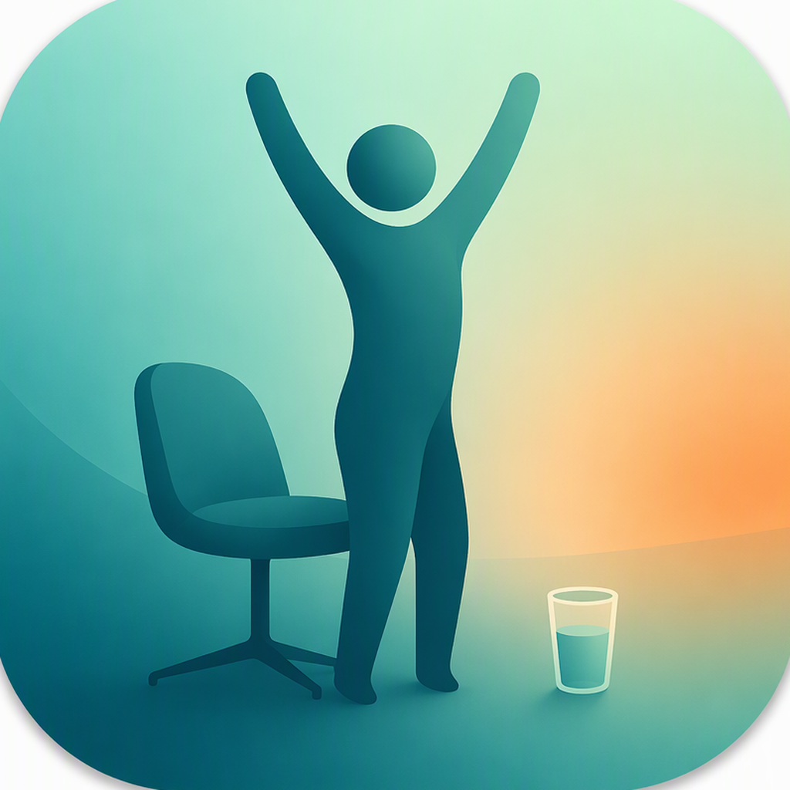

# UsageReminder · 久坐提醒


**[中文文档](README.zh-CN.md)**

A lightweight macOS menu-bar app that watches your *real* keyboard/mouse activity and reminds you to drink water and stand up — before your back complains.

<p align="center">
  
</p>

No permissions required. No network. No accounts. All data stays in a local JSON file.

## ✨ Features

- **Real activity tracking** — reads the system's HID idle time; sleep and lock screen are handled automatically
- **Always-on Dynamic Island** — a pure-black capsule fused with the MacBook notch (matching shoulder curves, flush top edge, zero extra height). The left ear shows a status icon, the right ear your live session minutes — glance up, no clicks needed
- **Everything lives in the island** — left-click expands a mini dashboard (session, today, next reminder countdown); right-click opens the full settings panel. No menu-bar icon at all
- **Reminders expand from the island** — water/stand alerts spring out of the capsule with a close button; modal alert and banner styles also available
- **Configurable everything** — water reminder (default 45 min), stand reminder (60 min), break threshold (5 min), repeat interval (15 min)
- **Smart repeat** — if you ignore a reminder and keep sitting, it nags you every 15 minutes until you actually take a break
- **Multi-slot quiet hours** — lunch-break, evening and overnight presets in any combination (midnight-crossing supported); reminders pause, tracking continues
- **Positive reinforcement** — a cheerful notification when you actually take that break
- **Menu-bar dashboard** — current streak, countdown to next reminder, today's totals, last 7 days at a glance
- **Stats window** — 7-day bar chart + today's details (SwiftUI Charts)
- **Health tips** — every reminder ships with a random eye/neck/hydration tip
- **Bilingual UI** — follows your system language (中文 / English)
- **Launch at login** — one click in the menu
- **Universal binary** — Apple Silicon & Intel

## 📸 Screenshots

| Dynamic Island (idle) | Island reminder | Settings (right-click) |
| --- | --- | --- |
|  |  |  |

| Stats window |
| --- |
|  |

Left-click the island for a quick dashboard · right-click for settings.

## 📦 Install

1. Download `久坐提醒.zip` from [Releases](https://github.com/rainchen88/UsageReminder/releases)
2. Unzip and drag `久坐提醒.app` into `/Applications`
3. First launch: **right-click → Open** (the app is not notarized yet)
4. Requires **macOS 14+**

## 🔧 Build from source

```bash
git clone https://github.com/rainchen88/UsageReminder.git
cd UsageReminder
./build.sh        # produces 久坐提醒.app (universal binary)
```

Requires Xcode Command Line Tools (`xcode-select --install`).

## 🧠 How it works

- Idle time comes from `IOHIDSystem → HIDIdleTime` (IOKit) — no Accessibility or Input Monitoring permission needed
- Polls every 5 seconds; idle ≥ break threshold ⇒ break recorded, streak resets
- Data lives in `~/Library/Application Support/UsageReminder/` (`config.json` + `data/stats.json`)
- the island is a borderless NSPanel pinned to the top-center of the screen; strong alerts are native AppleScript dialogs; gentle mode uses standard notifications

## 🗺 Roadmap

- [ ] Mac App Store release (sandbox: migrate alerts to `UNUserNotificationCenter`)
- [ ] Notarized Developer ID build
- [ ] Weekly/monthly report view
- [ ] Focus-mode awareness (auto-pause during meetings)

Contributions and issues welcome!

## 📄 License

MIT
