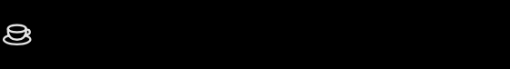
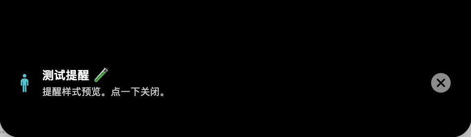
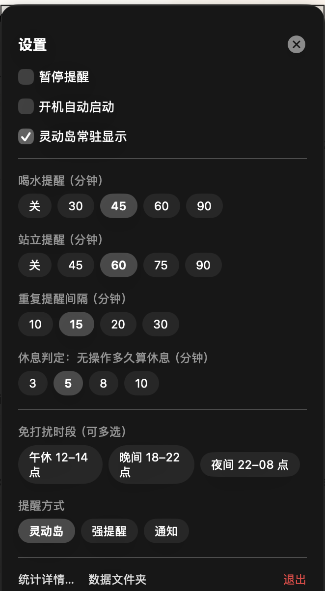
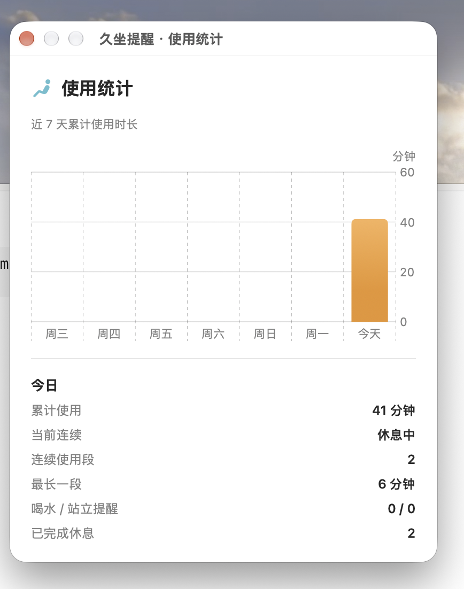

# 久坐提醒（UsageReminder）

**[English](README.md)**

一款 macOS 菜单栏小工具：根据你真实的键鼠操作监控连续使用时长，到点提醒你喝水、站起来活动，并统计每日使用情况。

无需任何权限、不联网、无账号，所有数据保存在本地 JSON 文件里。

## ✨ 功能

- **真实使用监控**：读取系统键鼠空闲时间，无需任何权限；睡眠、锁屏自动暂停
- **灵动岛常驻**：纯黑胶囊与刘海融为一体（同款肩部弧线、顶边贴死、零额外高度），左耳状态图标、右耳实时分钟数，抬眼即看
- **一切操作都在岛上**：左键点击展开小看板（当前时长 / 今日累计 / 下次提醒倒计时），右键打开完整设置面板，菜单栏图标彻底取消
- **提醒从灵动岛展开**：喝水/站立提醒从胶囊里弹簧式弹出，带关闭按钮；也可切换强提醒弹窗 / 温和通知
- **全部可配置**：喝水（默认 45 分钟）、站立（60 分钟）、休息判定（5 分钟）、重复提醒（15 分钟）
- **智能重复**：提醒了你还坐着不动？每 15 分钟再催一次，直到你真正休息
- **免打扰多选时段**：午休 / 晚间 / 夜间任意组合，支持跨午夜，提醒暂停但计时继续
- **正向鼓励**：久坐后真的站起来休息了？收到一条鼓励通知
- **菜单栏看板**：当前连续时长、下次提醒倒计时、今日累计、连续段数、最长一段、提醒与休息次数、近 7 天概览
- **统计详情窗口**：近 7 天使用时长柱状图 + 今日明细
- **健康小贴士**：每次提醒随机附带一条护眼/拉伸/饮水建议
- **中英双语**：界面自动跟随系统语言
- **开机自动启动**：菜单一键开关
- **通用二进制**：Apple Silicon 和 Intel 都支持

## 📸 截图

| 灵动岛（休息中） | 灵动岛提醒 | 设置面板（右键打开） |
| --- | --- | --- |
|  |  |  |

| 统计窗口 |
| --- |
|  |

左键点胶囊看小看板，右键点胶囊开设置。

## 📦 安装

1. 从 [Releases](https://github.com/rainchen88/UsageReminder/releases) 下载 `久坐提醒.zip`
2. 解压后拖进「应用程序」文件夹
3. 首次打开：**右键 → 打开**（未公证，只需这一次）
4. 要求 **macOS 14 或以上**

## 🔧 从源码构建

```bash
git clone https://github.com/rainchen88/UsageReminder.git
cd UsageReminder
./build.sh        # 产出 久坐提醒.app（通用二进制）
```

需要 Xcode 命令行工具（`xcode-select --install`）。

## 🧠 实现原理

- 空闲时间来自 `IOHIDSystem → HIDIdleTime`（IOKit），不需要辅助功能/输入监控权限
- 每 5 秒轮询一次；无操作超过休息判定阈值 ⇒ 记一次休息，连续计时归零
- 数据存放在 `~/Library/Application Support/UsageReminder/`（`config.json` + `data/stats.json`）
- 灵动岛是钉在屏幕顶部中央的无边框 NSPanel；强提醒是原生 AppleScript 对话框；温和模式走系统通知

## 🗺  roadmap

- [ ] 上架 Mac App Store（沙盒改造：提醒迁移到 `UNUserNotificationCenter`）
- [ ] Developer ID 签名 + 公证
- [ ] 周报/月报视图
- [ ] 专注模式感知（开会时自动暂停）

欢迎提 Issue 和 PR！

## 📄 许可证

MIT
